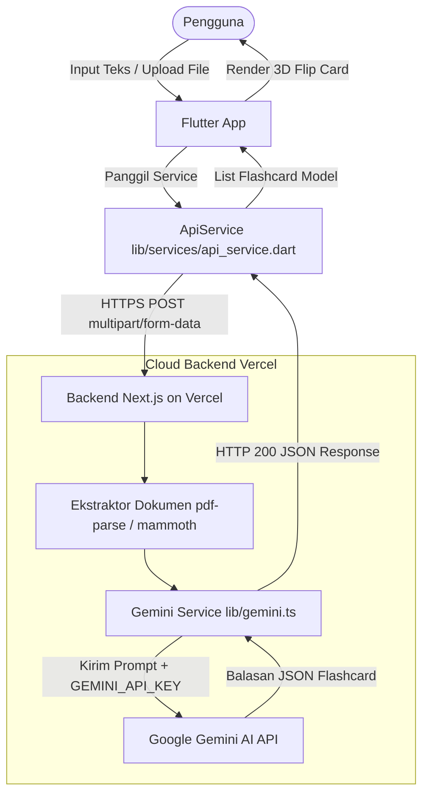

# FlashCard App (AI Flashcard Generator)

Aplikasi mobile berbasis Flutter yang mengubah materi belajar teks dan dokumen menjadi kartu belajar (*flashcard*) interaktif secara otomatis menggunakan kecerdasan buatan (*Google Gemini AI*).

---

## 1. Project Overview

* **Nama Aplikasi**: FlashCard (`flashcard_app`)
* **Tujuan**: Membantu siswa, mahasiswa, dan pembelajar membuat ringkasan evaluasi belajar secara cepat tanpa perlu menyusun pertanyaan dan jawaban secara manual.
* **Masalah yang Diselesaikan**: Menyusun kartu belajar dari materi tebal membutuhkan waktu lama dan melelahkan. Aplikasi ini mengotomatiskan proses ekstraksi konsep penting dan penyusunan kartu tanya-jawab.
* **Fungsi Utama**: Mengirim materi belajar ke backend cerdas, memproses konten dengan AI Gemini, dan menyajikannya dalam antarmuka kartu belajar yang interaktif dan dapat dibalik (*flip card*).
* **Jenis Input yang Didukung**:
  1. **Teks Langsung**: Menempel (*paste*) materi bacaan atau catatan belajar.
  2. **Upload Dokumen**: Mengunggah dokumen berformat **PDF (`.pdf`)** atau **Microsoft Word (`.docx`)**.
* **Hasil**: Daftar flashcard tanya-jawab dengan visualisasi kartu 3D, serta fitur ekspor flashcard ke format Markdown (`.md`) yang disimpan langsung ke memori perangkat.

---

## 2. Features

Fitur-fitur yang diimplementasikan pada source code:

* **AI Flashcard Generation**: Menghasilkan pertanyaan konsep dan jawaban ringkas secara otomatis menggunakan model Gemini AI.
* **Dual Input Mode**:
  * Mode **Upload File**: Mendukung file biner `.pdf` dan `.docx` hingga 20 MB.
  * Mode **Masukkan Teks**: Input materi berupa paragraf teks langsung.
* **Kustomisasi Jumlah Kartu**: Pengguna dapat menentukan jumlah flashcard yang dihasilkan (rentang 1 hingga 10 kartu).
* **Interactive 3D Flip Card**: Kartu pertanyaan yang dapat dibalik ke sisi jawaban menggunakan animasi rotasi 3D berkecepatan 450ms.
* **Ekspor ke Markdown (`.md`)**: Menyimpan seluruh hasil generate ke dalam file teks Markdown di direktori dokumen perangkat (`path_provider`).
* **Regenerate & Reset**: Tombol untuk mengulang proses pembuatan flashcard dari materi yang sama atau mereset form ke kondisi awal.
* **Runtime Backend URL Configuration**: Dialog terintegrasi untuk menyesuaikan URL API backend secara dinamis tanpa perlu melakukan kompilasi ulang kode.
* **Error Handling & Validasi**: Validasi ukuran file, kelayakan materi (minimal 50 karakter), penanganan status HTTP non-200, dan proteksi kegagalan jaringan.

---

## 3. Technology Stack

### Mobile Client (Flutter)
* **Framework**: Flutter (SDK `^3.13.4`, Material 3 design system)
* **Bahasa**: Dart
* **Dependencies Utama** (`pubspec.yaml`):
  * `http: ^1.6.0` — Manajemen request HTTP REST & Multipart Form-Data
  * `file_picker: ^8.1.2` — Pemilih dokumen file sistem lokal (PDF & DOCX)
  * `path_provider: ^2.1.6` — Akses penyimpanan direktori lokal Android/iOS
  * `google_fonts: ^9.0.0` — Tipografi font (*Inter* dan *JetBrains Mono*)
  * `cupertino_icons: ^1.0.8` — Aset ikon

### Backend & Cloud Service
* **Framework**: Next.js (App Router, Node.js)
* **Hosting**: Vercel Serverless Functions
* **AI Provider**: Google Generative AI SDK (`@google/generative-ai: ^0.21.0`)
* **Model AI**: `gemini-3.5-flash-lite` (dengan fallback otomatis ke `gemini-3.8-flash`)
* **Document Parsing**:
  * `pdf-parse: ^1.1.1` — Ekstraksi teks dari dokumen PDF
  * `mammoth: ^1.8.0` — Ekstraksi teks dari dokumen Word DOCX

---

## 4. System Architecture

Aplikasi memisahkan antarmuka pengguna (Flutter) dengan logika pemrosesan dokumen dan pemanggilan AI (Next.js di Vercel). **Aplikasi Flutter tidak menyimpan maupun memanggil Gemini API Key secara langsung**, sehingga kunci rahasia API tetap aman di sisi server.



### Fungsi Masing-Masing Komponen:
1. **Flutter App (`flashcard_app`)**: Mengelola antarmuka pengguna, validasi input, status animasi kartu, dan penyimpanan file Markdown lokal.
2. **`ApiService`**: Membentuk payload `MultipartRequest`, menangani batas waktu jaringan (*timeout* 90 detik), dan memvalidasi respon server.
3. **Backend Next.js (`ai-flashcard-generator`)**: Menerima request HTTP, mengekstrak isi teks dokumen PDF/DOCX menjadi teks mentah, dan memvalidasi panjang karakter.
4. **Google Gemini AI**: Menghasilkan pertanyaan dan jawaban esensial berdasarkan materi yang diberikan dalam format JSON terstruktur.

---

## 5. Request Flow

Berikut adalah tahapan pembuatan flashcard dari awal hingga tampil di layar:

1. **Input Materi**: Pengguna memasukkan teks materi belajar pada text area atau memilih file `.pdf`/`.docx` melalui `FilePicker`.
2. **Pemilihan Jumlah**: Pengguna menentukan jumlah flashcard yang diinginkan (antara 1 sampai 10).
3. **Trigger Generate**: Pengguna menekan tombol **"Buat Flashcard"**, memicu method `_handleGenerate()` di `lib/pages/home_page.dart`.
4. **Panggilan Service**: `_handleGenerate()` memanggil fungsi statis `ApiService.generateFlashcards()`.
5. **Penyusunan Multipart**: `ApiService` mengemas data ke dalam `http.MultipartRequest('POST', uri)` dengan field `inputType`, `cardCount`, dan `text` atau file biner `file`.
6. **Pengiriman HTTPS**: Request dikirim ke endpoint `https://flashcard-kamu.vercel.app/api/generate`.
7. **Penerimaan Backend**: Endpoint `app/api/generate/route.ts` mem-parsing FormData dari client.
8. **Ekstraksi Konten**: Jika input berupa file, backend mengonversi buffer file menjadi teks menggunakan `extractTextFromPDF` atau `extractTextFromDOCX`.
9. **Generasi AI**: Backend memanggil `generateFlashcardsWithGemini()` di `lib/gemini.ts` untuk memicu model Gemini dengan prompt yang mewajibkan format JSON.
10. **Respon JSON**: Backend memvalidasi JSON dari Gemini dan mengembalikan respon HTTP 200 dengan struktur `{"flashcards": [...]}`.
11. **Deserialisasi Data**: `ApiService` membaca respon stream, mem-parsing JSON, dan mengonversinya menjadi objek `List<Flashcard>` melalui `Flashcard.fromJson()`.
12. **Penyajian UI**: State aplikasi berubah menjadi `AppState.result`, dan kartu flashcard ditampilkan menggunakan widget interaktif `FlipCardWidget`.

---

## 6. API Documentation

### Endpoint: Generate Flashcards
Memproses teks atau file dokumen dan menghasilkan daftar flashcard.

* **URL**: `https://flashcard-kamu.vercel.app/api/generate`
* **HTTP Method**: `POST`
* **Content-Type**: `multipart/form-data`

#### Request Fields

| Field | Tipe | Wajib | Keterangan |
| :--- | :--- | :--- | :--- |
| `inputType` | `String` | Ya | Pilihan: `"text"` atau `"file"` |
| `cardCount` | `String` / `int` | Ya | Angka antara `1` sampai `10` |
| `text` | `String` | Kondisional | Wajib jika `inputType = "text"`. Minimal 50 karakter. |
| `file` | `Binary File` | Kondisional | Wajib jika `inputType = "file"`. Format `.pdf` atau `.docx` (maks 20MB). |

#### Contoh Respon Sukses (HTTP 200 OK)

```json
{
  "flashcards": [
    {
      "question": "Apa fungsi utama dari protokol HTTPS?",
      "answer": "Mengamankan komunikasi data melalui enkripsi end-to-end antara client dan server menggunakan sertifikat SSL/TLS."
    },
    {
      "question": "Bagaimana cara kerja model stateless pada arsitektur REST?",
      "answer": "Setiap request dari client ke server harus memuat seluruh informasi yang dibutuhkan tanpa menyimpan session context di server."
    }
  ]
}
```

#### Contoh Respon Gagal (HTTP 400 / 422 / 500)

```json
{
  "error": "Materi terlalu pendek (kurang dari 50 karakter). Silakan masukkan atau upload materi yang lebih lengkap."
}
```

---

## 7. Flutter Project Structure

Struktur direktori kode aplikasi:

```text
flashcard_app/
├── android/                        # Konfigurasi native Android & AndroidManifest.xml
├── lib/
│   ├── main.dart                   # Titik masuk aplikasi & konfigurasi tema global
│   ├── models/
│   │   └── flashcard.dart          # Data model Flashcard (question & answer)
│   ├── pages/
│   │   └── home_page.dart          # Tampilan antarmuka utama, interaksi input, & ekspor Markdown
│   ├── services/
│   │   └── api_service.dart        # Service komunikasi jaringan HTTP ke endpoint backend
│   └── widgets/
│       └── flip_card.dart          # Komponen UI kartu dengan animasi rotasi 3D saat di-tap
├── pubspec.yaml                    # Manajemen paket dependensi & aset Flutter
└── README.md                       # Dokumentasi resmi project
```

### Penjelasan File Inti:
* `lib/main.dart`: Menginisialisasi binding Flutter dan menyetel tema aplikasi dengan warna monokrom clean dan tipografi font *Inter*.
* `lib/models/flashcard.dart`: Model representasi data kartu yang memiliki properti `question` dan `answer`, serta factory method `fromJson` dan `toJson`.
* `lib/pages/home_page.dart`: Mengelola alur UI mulai dari tab pemilihan input (teks/file), kalkulasi ukuran dokumen, counter jumlah kartu, status loading/error, hingga penyimpanan file `.md` ke storage.
* `lib/services/api_service.dart`: Mengirim multipart request, mengelola batas waktu (*timeout* 90 detik), serta menerjemahkan pesan error jaringan dan status kode HTTP.
* `lib/widgets/flip_card.dart`: Menggunakan `AnimationController` dan `Transform` dengan matriks perspektif 3D untuk membalik kartu pertanyaan menjadi jawaban saat diklik.

---

## 8. API Service (`api_service.dart`)

File [api_service.dart](file:///c:/125/MobCom/flashcard_app/lib/services/api_service.dart) adalah penghubung tunggal antara antarmuka Flutter dan server backend.

* **Base URL**:
  ```dart
  static String baseUrl = 'https://flashcard-kamu.vercel.app';
  ```
* **Endpoint URI**: `$cleanBaseUrl/api/generate`
* **Multipart Form-Data**: Mendukung pengiriman file baik melalui `Uint8List` (`MultipartFile.fromBytes`) untuk lingkungan memory-based maupun path file lokal (`MultipartFile.fromPath`).
* **Timeout Proteksi**: Request dibatasi maksimal **90 detik**. Jika melebihi durasi ini, aplikasi otomatis melempar `TimeoutException`.
* **Error Handling Berlapis**:
  1. `SocketException`: Menampilkan instruksi memeriksa koneksi internet.
  2. `http.ClientException`: Menangani kegagalan level HTTP client.
  3. `HTTP 404`: Memberi informasi jika route endpoint tidak ditemukan di server.
  4. `HTTP 504`: Menangani pesan timeout dari gateway Vercel.
  5. `Non-JSON / Invalid Structure`: Memvalidasi keberadaan key `flashcards` dan memastikan array tidak kosong.

---

## 9. Backend Implementation

Implementasi backend berada pada proyek Next.js (`ai-flashcard-generator`):

1. **Penerimaan Request (`app/api/generate/route.ts`)**:
   Membaca request melalui `await request.formData()`, memvalidasi parameter `inputType`, `cardCount` (1–10), dan keberadaan payload.
2. **Ekstraksi Teks (`lib/extractText.ts`)**:
   * File PDF dibaca menggunakan buffer melalui paket `pdf-parse`.
   * File DOCX dibaca menggunakan `mammoth.extractRawText({ buffer })`.
   * Memvalidasi bahwa teks hasil ekstraksi memiliki panjang minimal 50 karakter dan bukan file scan gambar kosong tanpa OCR.
3. **Prompt Engineering & Gemini (`lib/gemini.ts`)**:
   * Membatasi teks materi maksimal 50.000 karakter (`MAX_CHARS`).
   * Menyusun system instruction ketat yang melarang AI menambahkan informasi di luar materi yang diberikan.
   * Mengatur `generationConfig` dengan `responseMimeType: "application/json"` dan `temperature: 0.7`.
   * Menerapkan fallback berjenjang dari model `gemini-3.5-flash-lite` ke `gemini-3.8-flash`.
   * Menerapkan mekanisme retry otomatis hingga 3 kali jika server Gemini sedang mengalami beban tinggi (status 503).

---

## 10. Environment Variables

Gemini API Key **wajib disimpan di backend** dan **tidak boleh dicantumkan di aplikasi mobile Flutter**:

* **Lokasi Backend Lokal**: `.env.local`
* **Nama Environment Variable**: `GEMINI_API_KEY`

Contoh isi `.env.example`:
```env
# File environment variable - JANGAN di-commit ke Git!
# Salin file ini dan rename menjadi .env.local
# Isi GEMINI_API_KEY dengan API key Anda dari https://aistudio.google.com/apikey

GEMINI_API_KEY=your_actual_gemini_api_key_here
```

> **Perhatian**: Jangan pernah mengunggah file `.env` atau `.env.local` yang berisi API key asli ke repository publik.

---

## 11. Local Development

### Menjalankan Flutter App
Pastikan Flutter SDK sudah terpasang di komputer Anda:

```bash
# Masuk ke direktori aplikasi Flutter
cd flashcard_app

# Pasang dependencies
flutter pub get

# Jalankan aplikasi (pilih target emulator / device)
flutter run
```

### Menjalankan Backend Next.js (Opsional)
Jika Anda ingin mengembangkan atau menguji backend secara lokal:

```bash
# Masuk ke direktori backend Next.js
cd ../ai-flashcard-generator

# Pasang dependencies
npm install

# Salin file environment dan isi API key Anda
cp .env.example .env.local

# Jalankan server development
npm run dev
```

*Server lokal akan berjalan di `http://localhost:3000`.*

#### Panduan Akses Backend Lokal:
* **Android Emulator**: Akses host laptop melalui `http://10.0.2.2:3000`.
* **Browser / Desktop**: Akses melalui `http://localhost:3000`.
* **Perangkat Fisik**: Hubungkan perangkat ke jaringan Wi-Fi yang sama dengan laptop dan gunakan IP LAN laptop (misalnya `http://192.168.1.100:3000`).

> **Catatan**: Jika menggunakan backend Vercel yang sudah dideploy (`https://flashcard-kamu.vercel.app`), Anda **tidak perlu** menjalankan backend lokal.

---

## 12. Production Deployment (Vercel)

Alur komunikasi production:

```text
Flutter APK (Android) 
   ──[ HTTPS ]──> Vercel Edge / Serverless 
   ──[ Node.js Route ]──> Google Gemini API
```

### Pengaturan di Vercel:
1. Buka dashboard proyek Anda di [Vercel](https://vercel.com).
2. Masuk ke **Settings** > **Environment Variables**.
3. Tambahkan key:
   * **Key**: `GEMINI_API_KEY`
   * **Value**: *API key Gemini Anda dari Google AI Studio*
   * **Environment**: Centang `Production`, `Preview`, dan `Development`.
4. Lakukan **Redeploy** agar konfigurasi aktif.

---

## 13. Build APK Release

Untuk membuat paket instalasi Android (`.apk`) yang siap dibagikan ke pengguna lain:

```bash
# Bersihkan build cache
flutter clean

# Perbarui paket dependensi
flutter pub get

# Kompilasi APK release
flutter build apk --release
```

* **Lokasi File Output**:
  ```text
  build/app/outputs/flutter-apk/app-release.apk
  ```

> **Penting**: APK release menggunakan endpoint HTTPS internet (`https://flashcard-kamu.vercel.app`). Jangan membuat APK release menggunakan target `localhost` atau `10.0.2.2` karena tidak akan dapat diakses di luar lingkungan emulator lokal Anda.

---

## 14. Sharing the Application

Aplikasi ini dapat dibagikan kepada teman, dosen, atau penguji dengan sangat mudah:

1. Kirimkan file `app-release.apk` langsung ke perangkat pengguna lain.
2. Pengguna cukup menginstal APK pada smartphone Android mereka.
3. **Keuntungan arsitektur ini**:
   * Pengguna **tidak perlu** menginstal Node.js, Flutter, atau Git di laptop mereka.
   * Pengguna **tidak perlu** menyalakan server lokal di komputer.
   * Pengguna **tidak perlu** membuat akun Google AI Studio atau memiliki Gemini API key pribadi.
   * Selama backend Vercel aktif dan terhubung ke internet, aplikasi dapat digunakan kapan saja dan di mana saja.

---

## 15. Security Best Practices

1. **API Key Isolation**: Gemini API Key tidak pernah disertakan dalam source code Dart, file aset, atau APK Flutter. Dekompilasi file APK tidak akan membocorkan API key Anda.
2. **Transport Security (HTTPS)**: Seluruh lalu lintas data antara perangkat Android dan server Vercel dienkripsi melalui protokol HTTPS.
3. **Cleartext Traffic**: Meskipun konfigurasi `android:usesCleartextTraffic="true"` aktif untuk kemudahan pengujian lokal, seluruh request production diarahkan ke domain ber-SSL valid (`https://`).
4. **Git Protection**: File `.env` dan `.env.local` telah terdaftar di `.gitignore` untuk mencegah kebocoran kredensial secara tidak sengaja ke GitHub.

---

## 16. Troubleshooting

| Masalah | Kemungkinan Penyebab | Solusi |
| :--- | :--- | :--- |
| **Tidak dapat terhubung ke server** | Perangkat tidak terhubung ke internet atau domain backend salah. | Pastikan smartphone memiliki koneksi internet aktif. Cek URL backend di dialog pengaturan aplikasi. |
| **Koneksi Timeout (90 detik)** | Materi terlalu panjang atau serverless function Vercel cold-start / timeout. | Coba ulangi request atau kurangi jumlah flashcard yang diminta. |
| **Materi terlalu pendek (< 50 karakter)** | Input teks terlalu singkat atau file dokumen tidak terbaca. | Masukkan materi pelajaran yang lebih lengkap dan berbobot. |
| **Gagal membaca file PDF / DOCX** | Dokumen hasil scan gambar tanpa OCR atau file rusak. | Pastikan dokumen berisi teks digital yang dapat di-blok/copy, bukan gambar hasil foto. |
| **Error HTTP 500 dari Backend** | Variabel `GEMINI_API_KEY` belum disetel di Vercel atau kuota API tercapai. | Periksa konfigurasi Environment Variables di dashboard Vercel Anda dan pastikan API key aktif. |
| **Format respon tidak valid** | Respon AI bukan format JSON yang valid. | Tekan tombol reset atau ulangi pembuatan (*regenerate*). Sistem backend sudah dilengkapi parser otomatis. |

---

## 17. Development Notes

Panduan cepat untuk pengembang berikutnya:

* **Mengubah Base URL Backend**:
  Buka [lib/services/api_service.dart](file:///c:/125/MobCom/flashcard_app/lib/services/api_service.dart) lalu ubah variabel `baseUrl`:
  ```dart
  static String baseUrl = 'https://url-backend-anda.vercel.app';
  ```
* **Mengubah Batas Jumlah Flashcard**:
  Buka [lib/pages/home_page.dart](file:///c:/125/MobCom/flashcard_app/lib/pages/home_page.dart) pada fungsi counter `_buildCounterButton` untuk mengubah batas minimum (1) dan maksimum (10).
* **Menyesuaikan Model Gemini**:
  Buka file backend `lib/gemini.ts` pada array `models` untuk mengganti atau menambahkan model Gemini generasi terbaru.
* **Format Model Flashcard**:
  Jika ingin menambahkan metadata pada flashcard (misalnya kategori atau tingkat kesulitan), sesuaikan class `Flashcard` di [lib/models/flashcard.dart](file:///c:/125/MobCom/flashcard_app/lib/models/flashcard.dart) dan prompt di `lib/gemini.ts`.

---

## 18. License

Lisensi belum ditentukan (*proprietary / academic project*). Project ini dikembangkan untuk keperluan akademik dan pembelajaran Mobile Communication.
